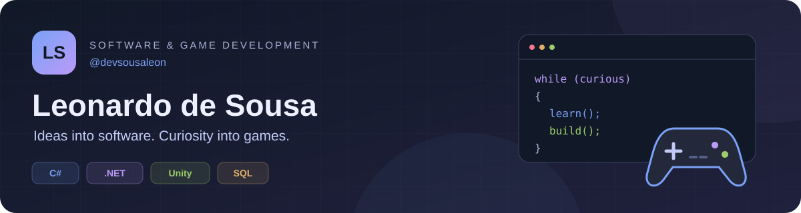
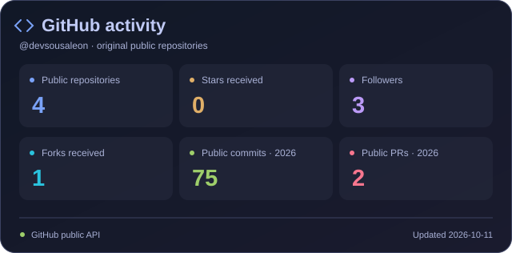
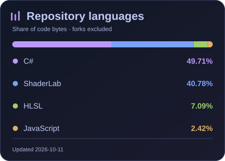

<div align="center">



# 👋 Hey, I'm Leonardo de Sousa

### C# & .NET Developer · Desktop Applications · Unity Game Development

I'm a Brazilian developer who enjoys turning ideas into practical software and playable experiences.

My main tools are **C#**, **.NET**, **Unity**, and **SQL**. I work on desktop applications, database integration, and game mechanics, with attention to clear business rules, consistent interfaces, and maintainable code.

[](https://www.linkedin.com/in/leonardo-de-sousa-aa20912a5/)
[](mailto:sousaleon1508@gmail.com)

</div>

---

## 🧑‍💻 About me

- 🖥️ I build desktop tools with **.NET, WinForms, and DevExpress**.
- 🗃️ I work with relational databases and **Entity Framework Core**, connecting application behavior to persistent data.
- 🎮 I recreate classic games in **Unity** and explore my own ideas for 2D gameplay.
- 🧩 I enjoy refining existing projects: naming conventions, interface consistency, authentication, and the organization of business logic.
- ⚙️ I'm interested in automating repetitive work, including workflows that connect forms, spreadsheets, and reports.
- 🌱 I'm expanding my knowledge of **backend development, software architecture, and game development**.

```csharp
public class LeonardoSousa
{
    public string Role => "C# / .NET Developer";
    public string Location => "Brazil";

    public string[] MainStack => new[]
    {
        "C#", ".NET", "Unity", "SQL"
    };

    public string[] CurrentlyExploring => new[]
    {
        "Backend development and software architecture",
        "Original 2D games and reusable game systems",
        "Workflow automation",
        "Local AI tools and AI-assisted development"
    };
}
```

## 🛠️ Tech stack

**Languages & application development**


**Databases**


**Tools & organization**


## 📌 Selected projects

| Project | What I've been building | Stack |
| --- | --- | --- |
| [🖥️ JustDoTheWork](https://github.com/devsousaleon/JustDoTheWork) | A desktop task management system covering creation, execution, pause, and completion, with time tracking, activity history, report templates, and user management. | C#, .NET 8, WinForms, DevExpress, EF Core, SQL Server / PostgreSQL |
| [🎮 Classic game recreations](https://github.com/devsousaleon/unity-2d-projects) | Recreations of Space Invaders, Breakout, and Pong, exploring classic gameplay alongside additional modes and maps. | Unity, C# |

## 🔭 What I'm exploring

**Software:** clearer architecture, backend services, and automation that reduces repetitive manual work.

**Games:** original 2D concepts with approachable mechanics, reusable assets, and a scope I can develop step by step.

**AI:** experimenting with local tools such as Ollama and learning how to guide AI agents while reviewing their output and making the technical decisions.

## 📊 GitHub activity

<div align="center">

<a href="https://github.com/devsousaleon">
  
  
</a>

<sub>Public GitHub data · updated daily · language percentages reflect code size in repositories.</sub>

</div>

## 🌎 Languages

| Language | Level |
| --- | --- |
| 🇧🇷 Portuguese | Native |
| 🇺🇸 English | Intermediate |

## 📬 Let's connect

I'm happy to talk about **C#**, **desktop applications**, **Unity**, **automation**, and the process of learning through real projects.

<div align="center">

[](https://www.linkedin.com/in/leonardo-de-sousa-aa20912a5/)
[](mailto:sousaleon1508@gmail.com)

<br />

**Building useful software. Exploring game systems. Learning with every project.**

</div>
